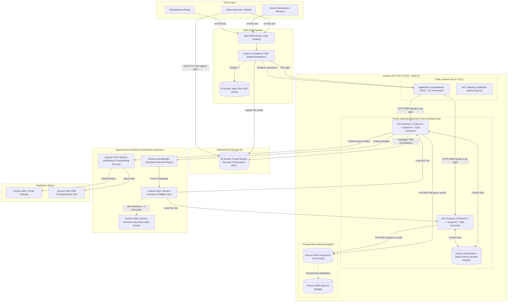
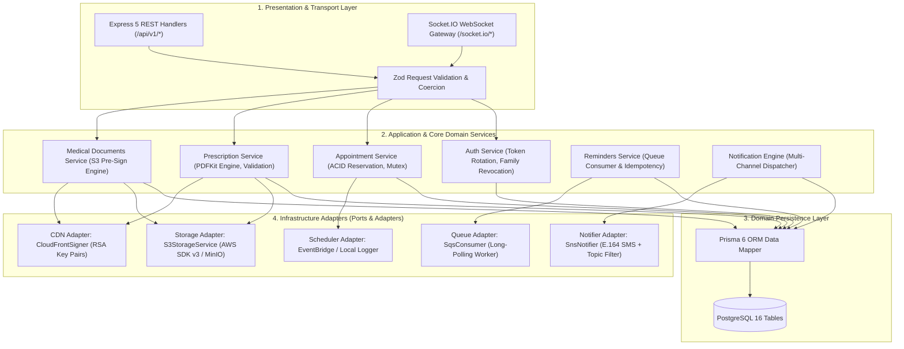
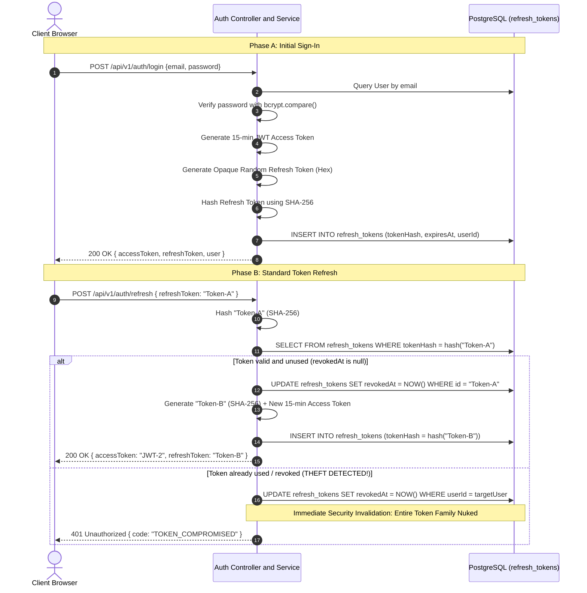
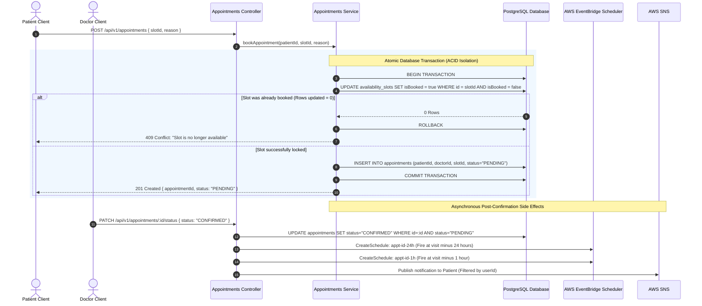
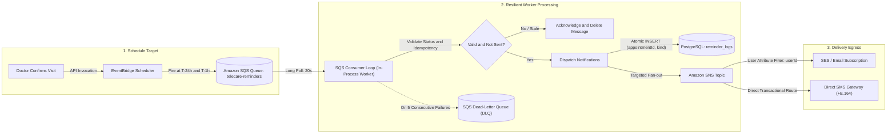
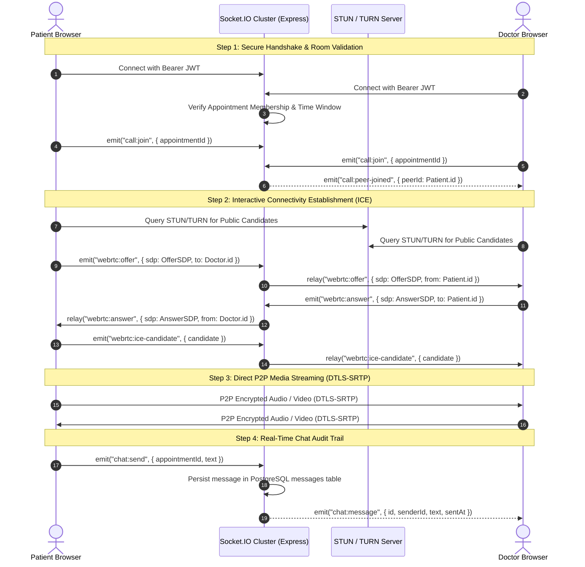
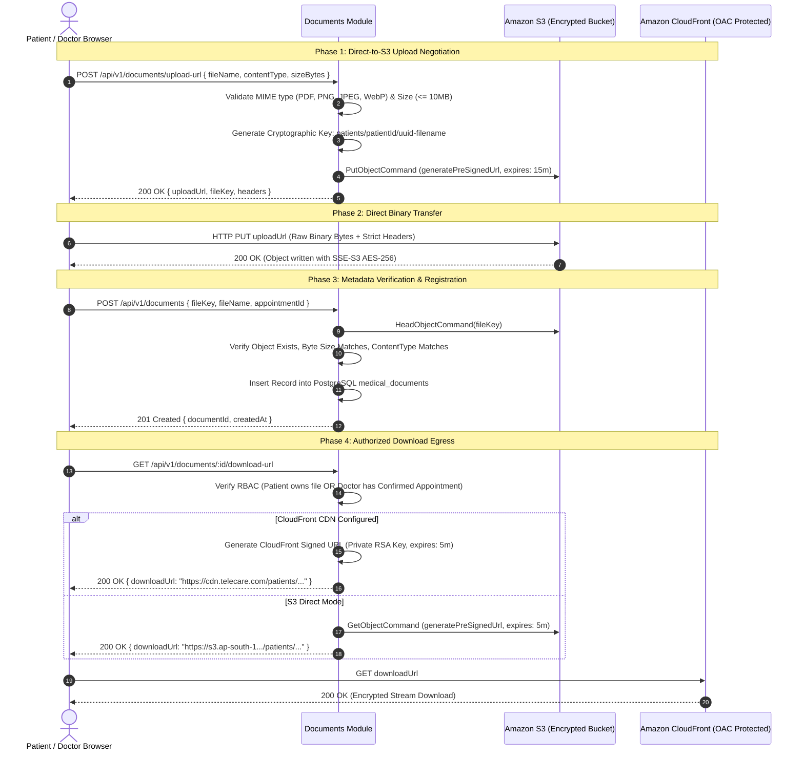
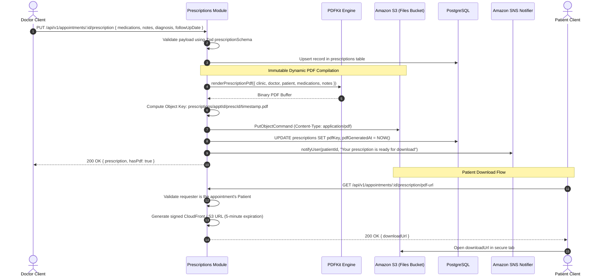
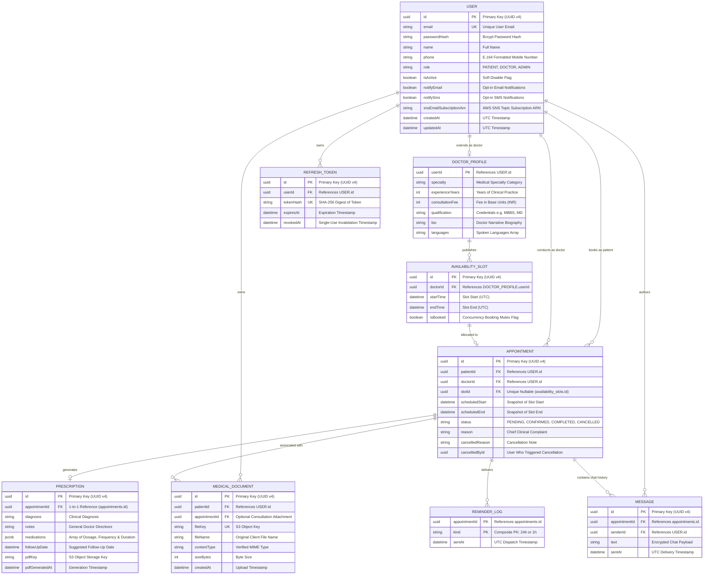
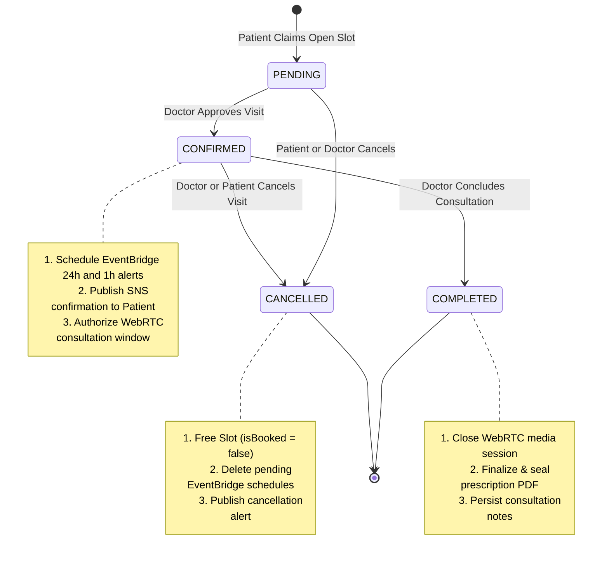

# Cloud-Native Telemedicine & Virtual Care Platform
### Enterprise-Grade Healthcare Architecture & Production Engineering Specification

[](https://nodejs.org/)
[](https://www.typescriptlang.org/)
[](https://react.dev/)
[](https://expressjs.com/)
[](https://www.prisma.io/)
[](https://www.postgresql.org/)
[](https://aws.amazon.com/)
[](https://webrtc.org/)
[](LICENSE)

---

## 1. Executive Summary & Architectural Vision

The **Telemedicine & Virtual Care Platform** is an enterprise-class, HIPAA-aligned digital healthcare system engineered for low-latency virtual consultations, high-concurrency appointment scheduling, zero-trust electronic medical records (EMR) exchange, and resilient multi-channel asynchronous patient notifications.

The system is architected around **event-driven, decoupled micro-components** and **clean domain boundaries**, eliminating single points of failure while enforcing stringent data privacy and least-privilege security perimeters.

```
                              ┌──────────────────────────────────────────────────────────┐
                              │               CORE ARCHITECTURAL PILLARS                 │
                              └──────────────────────────────────────────────────────────┘
           ┌─────────────────────────┬─────────────────────────┬─────────────────────────┬─────────────────────────┐
           ▼                         ▼                         ▼                         ▼                         ▼
┌─────────────────────┐   ┌─────────────────────┐   ┌─────────────────────┐   ┌─────────────────────┐   ┌─────────────────────┐
│ Zero-Trust Security │   │ Ephemeral Ingestion │   │ Atomic Scheduling   │   │ High-Resilience     │   │ P2P WebRTC & Media  │
│ Strict RBAC, bcrypt │   │ Direct S3 pre-signed│   │ ACID transactions,  │   │ EventBridge + SQS   │   │ Peer-to-peer audio/ │
│ rotating JWT/token  │   │ uploads & CloudFront│   │ conflict-guarded    │   │ DLQ retry pipeline, │   │ video, DTLS-SRTP,   │
│ family theft defense│   │ signed download URLs│   │ concurrency locks   │   │ idempotent consumer │   │ WebSocket signaling │
└─────────────────────┘   └─────────────────────┘   └─────────────────────┘   └─────────────────────┘   └─────────────────────┘
```

---

## 2. Global Cloud Architecture & Network Perimeter

The production topology leverages AWS multi-tiered network isolation, separating public ingress from application compute and database persistence layers across multiple Availability Zones.

### 2.1 AWS Infrastructure & Topology Map



### 2.2 Security Group Firewall Perimeter

| Security Group | Inbound Rules | Outbound Rules | Purpose |
| :--- | :--- | :--- | :--- |
| `sg-alb` | `0.0.0.0/0:80` (HTTP &rarr; HTTPS 301)<br>`0.0.0.0/0:443` (HTTPS TLS 1.3) | `sg-app:4000` | Edge traffic ingress & TLS termination |
| `sg-app` | `sg-alb:4000` (Node.js API instance) | `0.0.0.0/0:443` (via NAT Gateway for AWS SDK)<br>`sg-db:5432` | Stateless compute isolation |
| `sg-db` | `sg-app:5432` only | None (Total egress lockdown) | Database isolation & PHI protection |

---

## 3. Modular Clean Architecture

The backend implements a **Hexagonal / Clean Architecture** pattern where application services encapsulate business domain logic and depend strictly on abstract infrastructure interfaces.



---

## 4. End-to-End Core Architectural Workflows

### 4.1 Authentication & Zero-Trust Token Rotation Lifecycle

To mitigate token replay attacks, authentication employs short-lived JWT access tokens paired with cryptographically hashed, single-use refresh tokens with automatic token family revocation upon theft detection.



---

### 4.2 Concurrency-Guarded Atomic Slot Booking

To guarantee that no doctor slot is ever double-booked under intense concurrent load, reservations execute inside an ACID transaction using optimistic state transitions.



---

### 4.3 Distributed Asynchronous Reminders Pipeline

Reminders are scheduled without holding persistent timers in memory, guaranteeing durability across application restarts.



---

### 4.4 Low-Latency Consultation: WebRTC Signaling & P2P Media

Video consultations utilize WebRTC for peer-to-peer audio/video streaming, relying on authenticated Socket.IO rooms purely for exchange of SDP session descriptions and ICE candidates.



---

### 4.5 Zero-Trust Medical Document Ingestion & Egress

PHI (Protected Health Information) files never traverse API server memory directly. The client negotiates short-lived, cryptographically signed credentials and transfers encrypted binaries directly to S3.



---

### 4.6 Clinical Prescription Issuance & PDF Lifecycle



---

## 5. Domain Data Model & Entity-Relationship Specification

The relational architecture is enforced via PostgreSQL foreign key constraints, composite unique indexes, and cascade-deletion rules mapped through Prisma 6.



---

## 6. Appointment State Machine

The lifecycle of every appointment is governed by a deterministic finite state machine ensuring illegal transitions are rejected at the database level.



---

## 7. Security Architecture & HIPAA Compliance Matrix

| Security Domain | Architectural Mechanism | Implementation Details |
| :--- | :--- | :--- |
| **Authentication** | Dual-Token JWT + Opaque Refresh Token | 15-minute RS256/HS256 access tokens. Refresh tokens stored as SHA-256 hashes; automatic revocation of token families on reuse detection. |
| **Password Security** | Bcrypt with Salt Rounds | Multi-pass salt generation; raw credentials never written to disk or logs. |
| **PHI Sanitization** | Zero-PHI Notification Policy | SNS emails and SMS contain timestamps, doctor names, and secure portal links only. No diagnoses or medicine names are ever dispatched via external SMS/Email carriers. |
| **Transport Encryption** | TLS 1.3 / Strict HTTPS | AWS CloudFront enforces HTTPS redirect. WebRTC audio/video encrypted via DTLS-SRTP. |
| **Data at Rest** | AES-256 Storage Encryption | RDS PostgreSQL encrypted with AWS KMS. S3 medical buckets enforce server-side SSE-S3 encryption. |
| **Storage Isolation** | S3 Private Buckets & OAC | Direct public bucket access is 100% blocked. Ingestion occurs via short-lived (15 min) pre-signed PUT URLs; egress occurs via CloudFront Origin Access Control (OAC) with signed URLs. |
| **Network Boundaries** | Multi-Tier VPC Segmentation | EC2 compute instances live in private subnets with no public IPs. Inbound traffic allowed strictly from ALB security group (`sg-alb`). RDS is restricted strictly to `sg-app`. |
| **Privilege Model** | AWS IAM Instance Profiles | EC2 instances authenticate to AWS APIs via IAM roles with least privilege. Zero access keys (`AWS_ACCESS_KEY_ID`) are stored on production servers. |

---

## 8. Technology Stack Specification

```
┌─────────────────────────────────────────────────────────────────────────────────────────────────┐
│                                     TECHNOLOGY MATRIX                                           │
└─────────────────────────────────────────────────────────────────────────────────────────────────┘
```

| Layer | Technology | Version | Architectural Rationale |
| :--- | :--- | :--- | :--- |
| **Frontend Framework** | React | 19.x | Modern concurrent rendering, transitions, and component composition. |
| **Language** | TypeScript | 5.x | End-to-end type safety between database models, API payloads, and UI components. |
| **Build Tooling** | Vite | 6.x | Lightning-fast HMR and optimized production asset chunking. |
| **Styling** | Tailwind CSS | 4.x | Utility-first, purgeable, zero-runtime CSS. |
| **State Management** | TanStack Query | 5.x | Server-state caching, automatic cache invalidation, and optimistic UI mutations. |
| **Backend Runtime** | Node.js | 24 LTS | High-throughput asynchronous I/O with native V8 engine optimizations. |
| **API Framework** | Express | 5.x | Enterprise HTTP routing with robust middleware pipeline and native Promise error handling. |
| **ORM / Data Access** | Prisma | 6.x | Type-safe query building, declarative schema migrations, and connection pooling. |
| **Database** | PostgreSQL | 16.x | ACID compliance, row-level locking, JSONB indexing, and rock-solid reliability. |
| **Realtime Engine** | Socket.IO | 4.8.x | Resilient WebSocket transport with HTTP long-polling fallback and Redis adapter clustering. |
| **Media Transport** | WebRTC | Native | Ultra-low latency peer-to-peer encrypted audio and video streaming. |
| **PDF Generation** | PDFKit | 0.16.x | Vector-based server-side streaming PDF generation for prescription documents. |
| **Cloud Infrastructure**| AWS Native | — | CloudFront, S3, ALB, EC2, EventBridge Scheduler, SQS, SNS, RDS PostgreSQL. |
| **Testing Harness** | Vitest | 3.x | Fast, unit and integration test runner with in-memory AWS and Prisma mocks. |

---

## 9. Repository Directory Anatomy

```
telemedicine/
├── .github/
│   └── workflows/ci.yml             # GitHub Actions CI: lint, typecheck, unit tests
├── backend/                         # Express 5 + Prisma backend service
│   ├── prisma/
│   │   ├── schema.prisma            # Declarative PostgreSQL schema & relations
│   │   ├── migrations/              # Incremental SQL migration history
│   │   └── seed.ts                  # Deterministic demo database seeder
│   ├── src/
│   │   ├── config/env.ts            # Strongly-typed environment parser (Zod)
│   │   ├── infrastructure/          # External boundary adapters (Ports & Adapters)
│   │   │   ├── cdn/                 # CloudFront signed URL generator
│   │   │   ├── notifications/       # SNS Notifier & Console fallback
│   │   │   ├── queue/               # SQS long-polling consumer worker
│   │   │   ├── scheduler/           # EventBridge Scheduler client
│   │   │   └── storage/             # S3 pre-signed upload & download adapter
│   │   ├── modules/                 # Domain modules (Controller -> Service -> Rules)
│   │   │   ├── appointments/        # Booking transactions & state management
│   │   │   ├── auth/                # JWT issuance, bcrypt hashing & token rotation
│   │   │   ├── doctors/             # Doctor profiles, search & directory
│   │   │   ├── documents/           # Direct-to-S3 medical file upload engine
│   │   │   ├── health/              # Liveness and readiness probes
│   │   │   ├── messages/            # Chat persistence & history
│   │   │   ├── notifications/       # User notification preference engine
│   │   │   ├── prescriptions/       # Clinical prescriptions & PDF compilation
│   │   │   ├── reminders/           # Asynchronous queue handler & idempotency
│   │   │   ├── slots/               # Weekly recurring schedule slot generator
│   │   │   └── webrtc/              # STUN/TURN credential negotiation
│   │   ├── shared/                  # Typed error classes, auth & validation middleware
│   │   ├── sockets/                 # Socket.IO connection handling & WebRTC signaling
│   │   ├── app.ts                   # Express application setup & middleware stack
│   │   └── server.ts                # HTTP, WebSocket & SQS worker bootstrapper
│   └── vitest.config.ts             # Backend Vitest configuration
├── frontend/                        # React 19 single-page application
│   ├── src/
│   │   ├── app/                     # Route configuration & role-based route guards
│   │   ├── components/              # Reusable design system components (buttons, modals)
│   │   ├── features/                # Domain-specific UI features
│   │   │   ├── admin/               # Administrator management & doctor onboarding
│   │   │   ├── appointments/        # Patient booking & appointment history
│   │   │   ├── auth/                # Authentication screens (Login, Register)
│   │   │   ├── consultation/        # Unified Room: WebRTC Call, Chat, Prescriptions
│   │   │   ├── doctor/              # Doctor schedule, slot builder & patient charts
│   │   │   ├── doctors/             # Doctor search, filtering & slot selection
│   │   │   ├── documents/           # Medical record upload & preview portal
│   │   │   └── notifications/       # Multi-channel notification settings
│   │   ├── lib/                     # API client, WebRTC media session & formatting utilities
│   │   └── types/                   # TypeScript contract definitions matching backend DTOs
│   └── vite.config.ts               # Vite configuration
├── docs/                            # Deep-dive architectural documentation & manuals
│   ├── AWS_DEPLOYMENT.md            # Step-by-step AWS provisioning runbook
│   ├── BACKEND_FLOW.md              # Backend module execution flows
│   └── FRONTEND_FLOW.md             # Frontend screen states & mutation lifecycles
├── infra/                           # Production AWS IAM policies & S3 CORS declarations
│   ├── ec2-instance-policy.json     # Least-privilege EC2 IAM policy
│   ├── files-bucket-cors.json       # S3 CORS policy for direct browser uploads
│   └── scheduler-role-policy.json   # EventBridge to SQS execution role policy
└── docker-compose.yml               # Local development stack (PostgreSQL + MinIO)
```

---

## 10. Local Development & Engineering Quick-Start

### 10.1 Prerequisites

- **Node.js**: v24.x LTS
- **Package Manager**: npm v10+
- **Container Engine**: Docker & Docker Compose (optional, for local PostgreSQL & MinIO)

### 10.2 Starting Supporting Services (Docker)

```bash
# Launch PostgreSQL (port 5432) and MinIO S3 (ports 9000/9001)
docker compose up -d
```

### 10.3 Backend Initialization

```bash
cd backend

# 1. Configure environment variables
cp .env.example .env

# 2. Install dependencies
npm install

# 3. Execute database schema migrations
npx prisma migrate dev

# 4. Seed database with initial administrators, doctors, and slots
npm run db:seed

# 5. Launch development server with hot-reload (http://localhost:4000)
npm run dev
```

> **Local Mode (Zero-AWS Dependency)**: If `SNS_TOPIC_ARN`, `SQS_REMINDER_QUEUE_URL`, and `SCHEDULER_ROLE_ARN` are left blank, the application automatically switches to in-memory/console logging adapters. All features (booking, consultation, PDF generation, uploads via MinIO) function seamlessly offline!

### 10.4 Frontend Initialization

```bash
cd frontend

# 1. Configure environment
cp .env.example .env

# 2. Install dependencies
npm install

# 3. Launch Vite development server (http://localhost:5173)
npm run dev
```

### 10.5 Quality Assurance & Test Verification

Both tiers feature rigorous automated testing pipelines that require zero cloud connectivity:

```bash
# Verify backend: Type checking, Linting, Unit & Integration Tests, Production Build
cd backend
npm run typecheck
npm run lint
npm test
npm run build

# Verify frontend: Type checking, Linting, Unit Tests, Production Bundle
cd ../frontend
npm run typecheck
npm run lint
npm test
npm run build
```

---

## 11. Role-Based Access Control (RBAC) Matrix

| Resource / Endpoint | Method | Patient | Doctor | Administrator |
| :--- | :---: | :---: | :---: | :---: |
| `/api/v1/auth/*` | `POST` | Public | Public | Public |
| `/api/v1/doctors` | `GET` | Yes | Yes | Yes |
| `/api/v1/doctors/:id/slots` | `GET` | Yes | Yes | Yes |
| `/api/v1/doctor/slots` | `POST / DELETE` | No | Yes (Own slots) | No |
| `/api/v1/appointments` | `POST` | Yes (Book visit) | No | No |
| `/api/v1/appointments/:id/status` | `PATCH` | Yes (Cancel) | Yes (Confirm/Cancel/Complete) | Yes (Supervisory) |
| `/api/v1/appointments/:id/prescription`| `PUT` | No | Yes (Assigned doctor) | No |
| `/api/v1/appointments/:id/prescription`| `GET` | Yes (Visit patient)| Yes (Assigned doctor) | Yes |
| `/api/v1/documents/upload-url` | `POST` | Yes (Own files) | No | No |
| `/api/v1/documents/:id` | `DELETE`| Yes (Own files) | No | No |
| `/api/v1/documents/:id/download-url` | `GET` | Yes (Own files) | Yes (If Confirmed Visit) | No |
| `/api/v1/admin/doctors` | `POST` | No | No | Yes (Create doctor) |
| `/api/v1/admin/appointments` | `GET` | No | No | Yes (Full audit) |

---

## 12. Operational Runbook & Production Deployment

For complete, step-by-step production deployment instructions, refer to the exhaustive guide:
**[`docs/AWS_DEPLOYMENT.md`](docs/AWS_DEPLOYMENT.md)**

### Key Deployment Steps:
1. **Network Provisioning**: Configure dual-AZ VPC, subnets, and security groups (`sg-alb`, `sg-app`, `sg-db`).
2. **Database Provisioning**: Deploy Amazon RDS PostgreSQL 16 Multi-AZ instance inside isolated private subnets.
3. **Storage Tier Setup**: Create private S3 files bucket and web asset bucket; attach CORS via `infra/files-bucket-cors.json`.
4. **Messaging Pipeline Setup**: Deploy SNS topic `telecare-notifications`, SQS queue `telecare-reminders`, and SQS Dead Letter Queue.
5. **Scheduler Setup**: Create EventBridge schedule group `telecare-reminders` and attach execution role `infra/scheduler-role-policy.json`.
6. **Application Compute**: Launch EC2 instances with IAM instance profile `infra/ec2-instance-policy.json`, attach to ALB target group, and configure environment variables in `/etc/telecare.env`.
7. **CloudFront CDN Distribution**: Deploy single CloudFront distribution routing `/*` to S3 Web Bucket, `/api/*` to ALB, and `/socket.io/*` to ALB with WebSocket support enabled.

---

## 13. Observability, Health Checks & Telemetry

The application exposes standardized health and readiness endpoints for load balancer health probes and container orchestrator lifecycles:

- **Liveness Probe**: `GET /api/v1/health`
  - Validates HTTP server responsiveness.
  - Returns: `200 OK { status: "ok", timestamp: "<ISO-8601>" }`
- **Readiness Probe**: `GET /api/v1/health/ready`
  - Validates active database connectivity via `prisma.$queryRaw` (SELECT 1).
  - Returns: `200 OK { status: "ready", database: "connected" }` or `503 Service Unavailable`.
- **Structured Logging**: Emitted via `pino` with JSON payloads, timestamps, error stack traces, and request correlation IDs.

---

## 14. Architecture Documentation Index

| Document | Focus & Scope |
| :--- | :--- |
| **[`docs/AWS_DEPLOYMENT.md`](docs/AWS_DEPLOYMENT.md)** | Comprehensive AWS cloud deployment runbook, IAM policies, and infrastructure configuration. |
| **[`docs/BACKEND_FLOW.md`](docs/BACKEND_FLOW.md)** | Deep-dive module logic, controller-to-service flows, and database transaction design. |
| **[`docs/FRONTEND_FLOW.md`](docs/FRONTEND_FLOW.md)** | Client-side routing, WebRTC call session lifecycle, TanStack Query mutations, and error handling. |
| **[`infra/`](infra/)** | IAM policies, trust relationships, and bucket policies used for production deployments. |

---

## 15. License & Contributions

This project is released under the **MIT License**. Engineered for production telemedicine systems, clinical research, and cloud computing architectural demonstrations.
